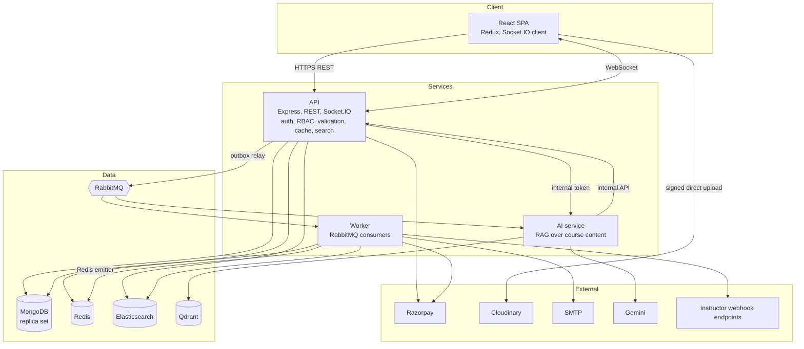
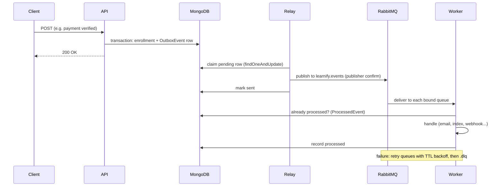

# Architecture

## Components



| Component | Responsibility | Scales by |
|---|---|---|
| **API** (`server/`) | Every HTTP endpoint, authentication and authorization, validation, caching, search queries, Socket.IO, and writing events to the outbox | More instances behind a load balancer: no in-process state (cache, rate limits, revocations, sockets, idempotency keys all live in Redis) |
| **Worker** (`server/workers`) | Side effects that are slow or can fail: email, refunds, search indexing, webhook fan-out and delivery | More instances: RabbitMQ distributes messages; consumers are idempotent |
| **AI service** (`ai-service/`) | Indexes course content into Qdrant, answers questions with retrieval and citations | Independently of the API; it has a different cost profile (slow external model calls) |

The API and worker are one codebase and one Docker image with two start commands. The AI service is a
separate codebase and image. Why only these splits: [DECISIONS.md](DECISIONS.md#1-a-modular-monolith-plus-two-services).

## Request path

```
client ─▶ helmet, CORS, metrics ─▶ rate limit (Redis) ─▶ auth (JWT + Redis denylist + DB user)
       ─▶ permission check (RBAC) ─▶ zod validation ─▶ idempotency key (Redis, where enabled)
       ─▶ controller ─▶ MongoDB (transaction when several documents change) + outbox row
       ─▶ response ─▶ audit entry (security-relevant routes)
```

- **Auth:** 15-minute access JWT in the `Authorization` header; a rotating refresh token in an httpOnly
  cookie scoped to `/api/v1/auth`. The user is loaded on every request, so deactivation, password changes
  (`tokenVersion`) and role changes apply immediately.
- **Reads** of the catalog are cached in Redis (cache-aside, versioned keys for instant invalidation,
  single-flight lock against stampedes).
- **Search** goes to Elasticsearch, falling back to MongoDB behind a circuit breaker.

## Event path (transactional outbox)



| Event | Consumers |
|---|---|
| `user.registered`, `otp.requested`, `password.reset_requested`, `password.changed`, `contact.submitted`, `course.completed` | email |
| `order.paid` | email, search-indexer (popularity), webhook-fanout |
| `payment.refund_requested` | refund (compensation for a paid order that could not be fulfilled) |
| `course.content_changed` | search-indexer, AI service (re-embed the course) |
| `review.created` | search-indexer (rating), webhook-fanout |
| `course.published`, `course.rejected` | webhook-fanout |
| `webhook.delivery_requested` | webhook-delivery (one message per delivery, own retry schedule) |

Guarantees: an event is recorded if and only if its business change commits; delivery is at-least-once;
consumers are idempotent, so the effect is once. Without `RABBITMQ_URL` the same consumers run in-process.

## Real-time

Socket.IO runs inside the API with the Redis adapter, so a message emitted on one instance reaches clients
connected to any instance. The worker emits through `@socket.io/redis-emitter` without hosting sockets.
Rooms: `user:<id>` (notifications), `lecture:<id>` (Q&A, viewer count), `liveclass:<id>` (chat). The
handshake uses the same access-token verification as HTTP.

## AI assistant (RAG)

Course content (description, lecture titles, descriptions, transcripts) is chunked, embedded with Gemini
and stored in Qdrant, filtered per course. A question is embedded, the closest chunks of that course are
retrieved above a similarity threshold chosen by an evaluation set, and the model answers from those
excerpts with citations, or says the course does not cover it. Only students, the instructor or admins of a
course can ask about it. Details: [AI.md](AI.md).

## Data

| Store | Holds | Notes |
|---|---|---|
| MongoDB | Source of truth for everything | Replica set for multi-document transactions; compound and covering indexes chosen with `explain()` |
| Redis | Cache, rate-limit counters, token buckets, revoked token ids, idempotency keys, Socket.IO adapter | Everything in it can be lost: each use falls back to in-process behaviour or recomputes |
| Elasticsearch | Search index of published courses | Derived from MongoDB; rebuildable with `npm run search:reindex` |
| Qdrant | Course chunk embeddings | Derived; rebuildable with `npm run reindex` in `ai-service` |
| RabbitMQ | Events in flight | Durable queues; the outbox is the source of truth if the broker loses anything |

## Failure behaviour

| Dependency down | Effect |
|---|---|
| Redis | Cache, rate limits and revocation checks fall back to per-process; sockets work on one instance only; nothing errors |
| RabbitMQ | Events wait in the outbox (requests still succeed); published when the broker returns |
| Worker | Messages queue up; nothing is lost; emails and indexing catch up when it restarts |
| Elasticsearch | Search falls back to MongoDB (circuit breaker); response says `engine: "mongo"` |
| AI service or Gemini | Chatbot falls back to an ungrounded answer marked as such |
| A webhook endpoint | Only that delivery retries; paused after 15 straight failures |
| SMTP, Razorpay refund API | Retries with backoff, then the dead-letter queue for a human |

## Observability

Prometheus metrics from the API and worker (HTTP latency per route, cache hit ratio, outbox lag, consumer
throughput, breaker state, business counters), RabbitMQ's own exporter, a provisioned Grafana dashboard,
alert rules, and OpenTelemetry traces that follow a request through the outbox and RabbitMQ into the worker.
Details: [OBSERVABILITY.md](OBSERVABILITY.md).
